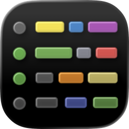

<p align="center"></p>

<h1 align="center">Total.js Code app</h1>

<p align="center">
  <a href="https://github.com/totaljs-es/code-app/releases/latest"></a>
  <a href="https://github.com/totaljs-es/code-app/releases"></a>
  
  
  <a href="https://tauri.app"></a>
  <a href="https://github.com/totaljs-es/code-app/actions/workflows/ci.yml"></a>
  <a href="LICENSE"></a>
</p>

Your [Total.js Code](https://github.com/totaljs/code) instances in an app of their own, for **Windows** and **Linux**: each instance opens in a window of its own, and Code keeps a local copy of its files in the folder you choose. Built with Tauri: a light installer of a few megabytes that uses the web view of the system. On the Mac and iPad, the app is [TotalCode](https://totaldesktop.totaljs.es/totalcode/), part of TotalDesktop.

**Website:** [totaldesktop.totaljs.es/totalcode](https://totaldesktop.totaljs.es/totalcode/) · **Privacy policy:** [totaldesktop.totaljs.es/totalcode/privacy](https://totaldesktop.totaljs.es/totalcode/privacy/)

## Download

The latest version, straight from [Releases](https://github.com/totaljs-es/code-app/releases/latest), where every file has its SHA-256:

| System | x64 (Intel, AMD) | ARM64 |
| --- | --- | --- |
| Windows 10 and 11 | [Installer (.exe)](https://github.com/totaljs-es/code-app/releases/latest/download/TotalJSCode-windows-x64-setup.exe) · [MSI](https://github.com/totaljs-es/code-app/releases/latest/download/TotalJSCode-windows-x64.msi) | [Installer (.exe)](https://github.com/totaljs-es/code-app/releases/latest/download/TotalJSCode-windows-arm64-setup.exe) |
| Debian, Ubuntu | [.deb](https://github.com/totaljs-es/code-app/releases/latest/download/TotalJSCode-linux-amd64.deb) | [.deb](https://github.com/totaljs-es/code-app/releases/latest/download/TotalJSCode-linux-arm64.deb) |
| Fedora, openSUSE | [.rpm](https://github.com/totaljs-es/code-app/releases/latest/download/TotalJSCode-linux-x86_64.rpm) | [.rpm](https://github.com/totaljs-es/code-app/releases/latest/download/TotalJSCode-linux-aarch64.rpm) |
| Any Linux | [AppImage](https://github.com/totaljs-es/code-app/releases/latest/download/TotalJSCode-linux-x86_64.AppImage) | [AppImage](https://github.com/totaljs-es/code-app/releases/latest/download/TotalJSCode-linux-aarch64.AppImage) |

**Windows:** the installer is not signed yet. The first time, SmartScreen says that it protected your PC: choose **More info → Run anyway**. It installs for your user only.

## What it does

- **Your instances:** name, address and, optionally, a folder for the local copy. Order them, search them and see whether each one is online and its version of Code.
- **One window per instance**, with its own sign-in, which the app remembers. A preview that Code opens is another window of the same instance; any other link opens in your browser.
- **Local copy of the files.** With a folder set, Code shows its desktop options: *Save locally*, *Download last changes locally*, *Download source-code locally*, *Download file locally* and *Always local storing files* in your account. Each repository gets its own subfolder.
- **Downloads** (a file, a bundle) go to the folder of the instance (bundles to `bundles/`), or to Downloads when it has none.
- **Import / Export** of the list, to move your instances to another computer.
- **View → Developer tools** (F12) and **Reload** (Ctrl+R).

## Security

The pages of Code get only what they need for the local copy, never the rest of the disk:

- Code sees the folder of the instance as `/local`. Every path is resolved inside the real folder after `..`, following symlinks, so nothing outside it can be read or written (`src-tauri/src/bridge.rs`, with tests).
- The pages of an instance can call only those file commands, only from its address and only in its windows; the list of instances and everything else is out of their reach.
- Downloads with the session cookie of Code go only to the instance itself.
- No tracking: the app talks only to your instances. See the [privacy policy](https://totaldesktop.totaljs.es/totalcode/privacy/).

## Development

Needs Node.js 22 and Rust (stable).

```bash
npm ci
npm run dev        # the app, on this machine
npm test           # the tests of the Rust part
npm run build      # the installers of this system, in src-tauri/target/release/bundle
```

- `src/index.html`, `app.js`, `app.css`: the list of instances.
- `src/bridge.js`: what every page of an instance gets before its own scripts.
- `src-tauri/src/lib.rs`: the windows, the menu and the commands; `bridge.rs`: the files; `projects.rs`: the list and its export format.

## Releasing

1. Change `version` in `package.json` and add it to `CHANGELOG.md`.
2. Commit, tag `v<version>` and push the tag. The `Release` workflow tests, builds Windows and Linux (x64 and ARM64) and publishes the release with the SHA-256 of each file.

## License

MIT
